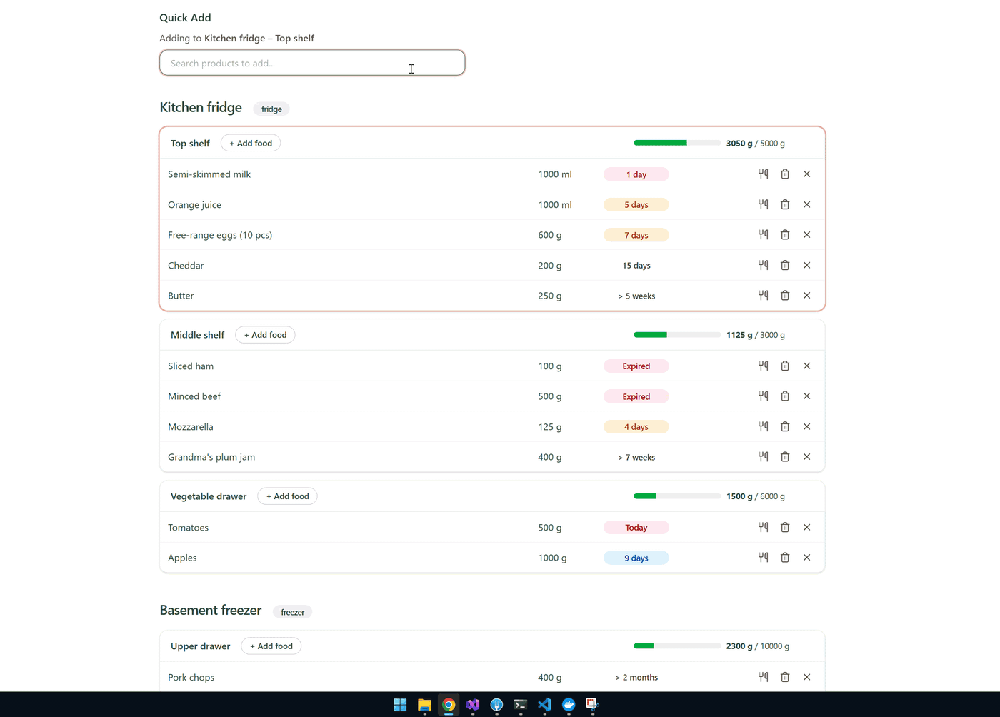
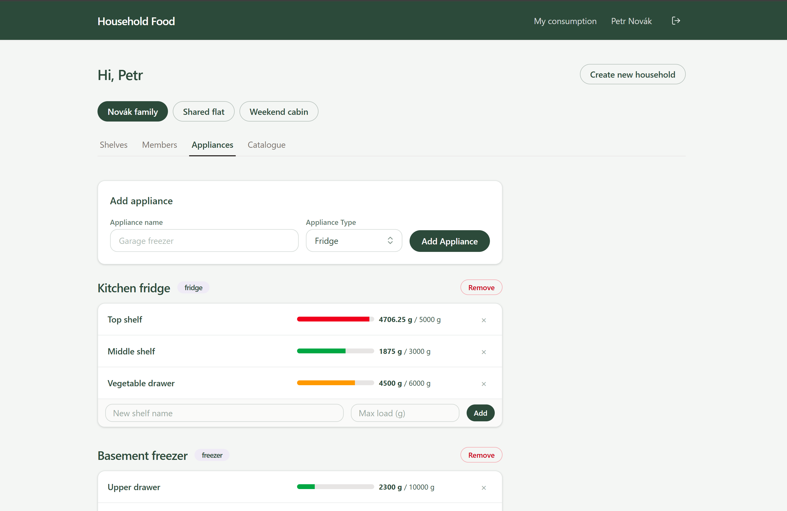
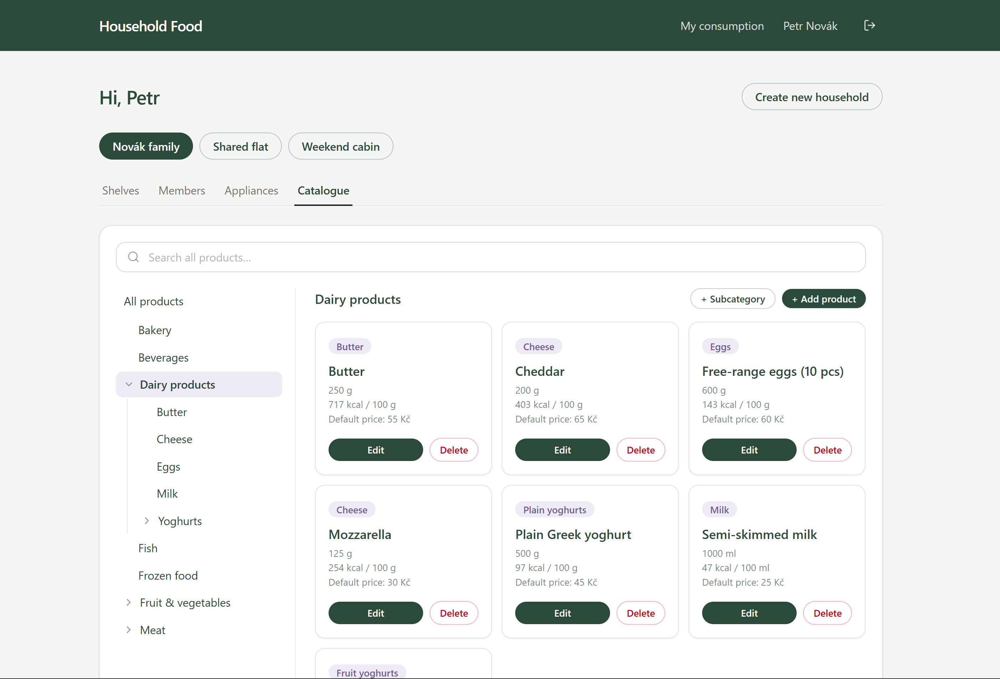

# FIT Lednice – Household Food Management

A web information system for managing food in households: fridges and freezers split into shelves, food items with
expiry dates and nutrition values, and a consumption profile that shows what you ate, your nutritional intake and
what it cost.

## Tech stack

| Layer | Technology |
|---|---|
| Backend | PHP 8.5, Laravel 13 |
| Frontend | Blade, Livewire 4 (with Alpine.js), Tailwind CSS 4, Vite |
| Database | MySQL 8 (Docker), Eloquent ORM, migrations, seeders |
| Testing | Pest (feature tests against a dedicated MySQL test database) |
| Code style | Laravel Pint |

## Screenshots

### Adding food with the quick search bar



### Appliances tab (household managers)



### Editable product catalogue (household managers)



## Functionality

- **Households** – a user creates a household and becomes its **owner**, then invites existing users by email.
  Roles: owner, manager, member.
- **Appliances & shelves** – each shelf has a maximum load. Adding food that would exceed it is refused.
- **Food items** – added from a multi-level product catalogue (e.g. *Dairy → Yoghurts → Plain yoghurts*), shown with
  expiry tags, and marked as consumed or thrown out.
- **Expiry alerts** – food that has expired or expires within 7 days is listed above the shelves.
- **Consumption profile** – consumed food over a day, a week or a custom range, with calories, macros and cost.
- **Per-household catalogue** – managers can customise categories and products without affecting other households.
- **Guest access** – a read-only view of a household through a revocable share link.
- **Profile** – users edit their details or deactivate their own account.
- **Administration** – an admin can search users, reactivate deactivated accounts, grant or revoke admin rights,
  and delete users.


## Running locally

Requirements: PHP 8.4+, Composer, Node.js, Docker.

```bash
# MySQL 8 in Docker
docker run -d --name mysql-laravel -p 3306:3306 -e MYSQL_ROOT_PASSWORD=secret mysql:8.0
docker exec mysql-laravel mysql -uroot -psecret -e "CREATE DATABASE my_app_db; CREATE DATABASE my_app_db_test;"

cp .env.example .env              # set DB_PASSWORD=secret
composer install
npm install
php artisan key:generate
php artisan migrate:fresh --seed  # demo households, shelves, food and 3 weeks of history
composer run dev                  # app on http://127.0.0.1:8000
```

Run the tests with `php artisan test --compact`.

### Demo account

Feel free to create an account or try the demo account:

| Email | Role | Passowrd |
|---|---|---|
| `test@email.com` | User | testuser |
